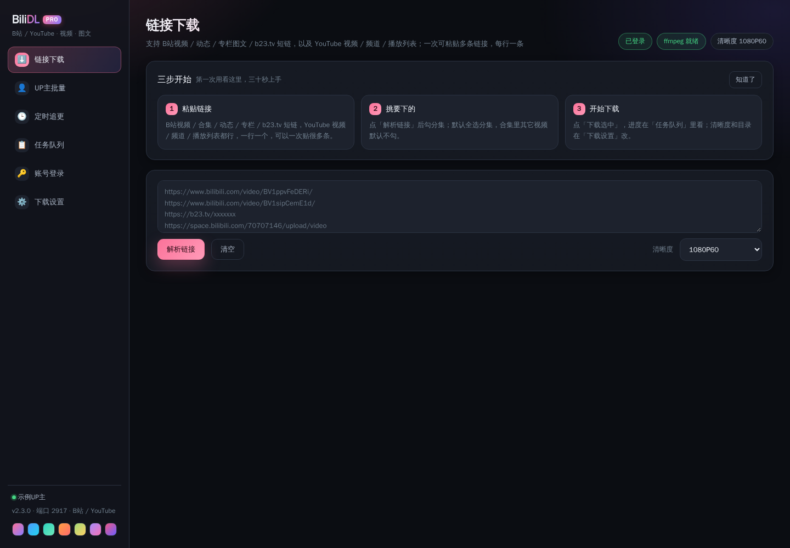
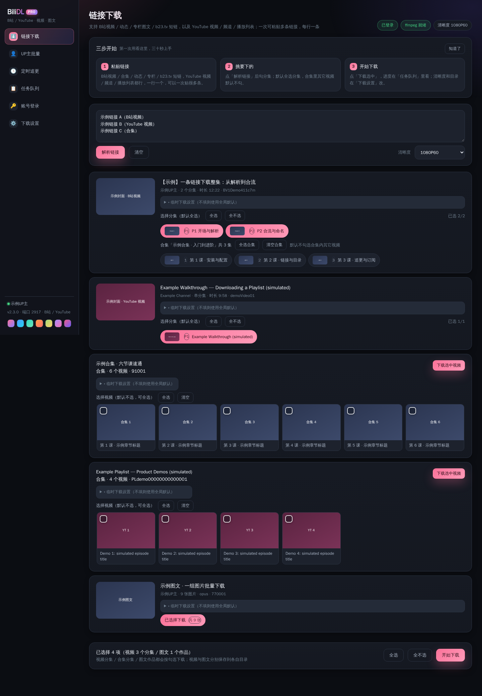
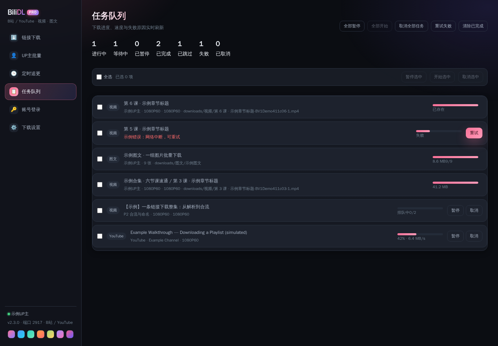
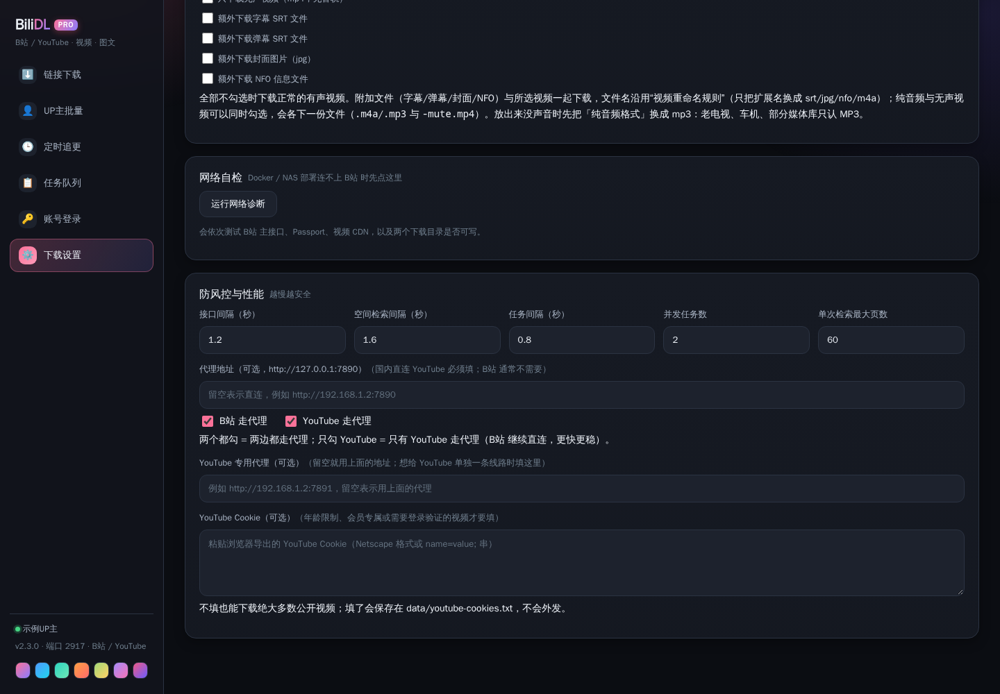
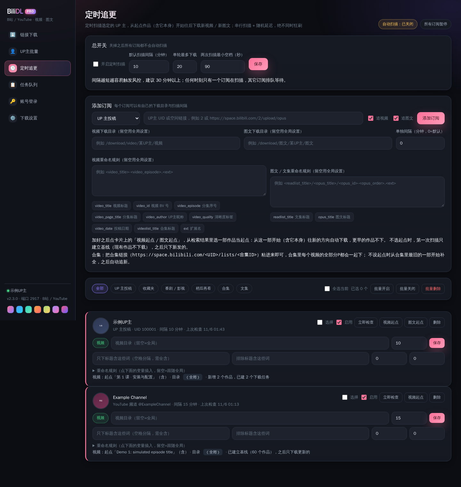

# BiliDL-PRO

> **B站 + YouTube 视频 / 图文下载器 · BiliDL 的升级版（Pro）**
>
> 一套下载引擎，四种形态（Docker / Windows / Android / 油猴脚本），一个 WebUI。
> 在 **BiliDL 2.2.12** 的基础上扩展而来：**新增 YouTube 下载与追更、代理分流、全新品牌与大量稳定性修复**。



> 本文所有截图均来自**模拟数据**的界面演示（示例视频 / 示例频道 / 示例任务），不含任何真实链接、真实视频或账号信息。

---

## 目录

- [1. 这是什么](#1-这是什么)
- [2. 与 BiliDL 的关系](#2-与-bilidl-的关系)
- [3. 界面](#3-界面)
- [4. 功能一览](#4-功能一览)
- [5. 四种安装形态](#5-四种安装形态)
- [6. 代理与网络（重点）](#6-代理与网络重点)
- [7. YouTube 的差异与限制](#7-youtube-的差异与限制)
- [8. 重命名模板与变量](#8-重命名模板与变量)
- [9. 清晰度](#9-清晰度)
- [10. 定时追更](#10-定时追更)
- [11. 目录结构](#11-目录结构)
- [12. 技术架构](#12-技术架构)
- [13. HTTP API](#13-http-api)
- [14. 常见问题](#14-常见问题)
- [15. 开发与测试](#15-开发与测试)
- [16. 许可与致谢](#16-许可与致谢)

---

## 1. 这是什么

BiliDL-PRO 是一个**自托管**的视频 / 图文下载器，把「解析链接 → 挑分集 → 排队下载 → 定时追更」整条链路做在一个网页里；B站 与 YouTube 共用同一套任务队列、命名规则、订阅系统与目录结构。

核心是一套纯 Python 下载引擎：

- **B站**：请求签名（WBI）、DASH 音视频分离流、ffmpeg 无损合流、风控识别与自动冷却；
- **YouTube**：通过 `yt-dlp` 解析与下载，自动处理 JS challenge、签名变换、清晰度映射与格式降级；
- **图文**：动态 / 专栏 / 文集 / 相册批量下载原图；
- **追更**：按间隔扫描订阅源，比对「已见清单」，只下载新增作品。

界面是纯标准库 HTTP 服务 + 原生 JS（无框架、无 CDN、无需构建），Docker 镜像、Windows 便携包、Android APK、油猴脚本四种形态共用同一份前端。

---

## 2. 与 BiliDL 的关系

BiliDL-PRO 是 **BiliDL（2.2.12）的升级版**，并非另起炉灶：B站 的全部能力、数据文件格式（`settings.json` / `queue.json` / `subs.json` / `cookie.txt`）与接口路径保持兼容，旧版的 `data/` 目录可以直接搬过来继续用。

| 能力 | BiliDL 2.2.12 | **BiliDL-PRO 2.3.0** |
| --- | --- | --- |
| B站 视频 / 图文 / 专栏 / 动态 / 空间 / 合集 | ✅ | ✅ 原样保留 |
| 定时追更（UP / 收藏夹 / 番剧 / 稍后再看 / 合集 / 文集） | ✅ | ✅ 并新增「起点」与模板重排优化 |
| **YouTube 视频 / 频道 / 播放列表下载** | ❌ | ✅ 新增 |
| **YouTube 频道定时追更** | ❌ | ✅ 新增 |
| **YouTube 字幕 / 封面 / NFO** | ❌ | ✅ 新增（无弹幕，见 §7） |
| **代理分流：B站 / YouTube 各自开关、各自地址** | ❌ | ✅ 新增 |
| **YouTube Cookie（登录态）支持** | ❌ | ✅ 新增 |
| 油猴脚本的 YouTube 面板 | ❌ | ✅ 新增（推送版 + 独立版） |
| 服务端口 / 容器名 | 2196 / `bilidl` | **2917 / `bilidl-pro`** |
| 品牌 | BiliDL | **BiliDL-PRO** |
| 其他 | — | 队列持久化细节、风控退避、诊断体检、模板重命名等多处修复 |

> 一句话：**B站 能干的，YouTube 基本都能干**——下载、选清晰度、挑分集、批量、命名模板、目录分流、定时追更、任务队列、暂停 / 重试、代理。差别只有两处：YouTube 没有弹幕；Android APK 仍是 B站 专用（见 [§7](#7-youtube-的差异与限制)）。

---

## 3. 界面

| 链接下载（解析结果） | 任务队列 |
| --- | --- |
|  |  |
| 多条链接一次粘贴，逐条解析成卡片；分集 pill 多选；每个作品可单独指定本次的目录与命名规则 | 进度、速度、失败原因、风控冷却、已跳过一屏看清；支持暂停、重试、批量取消 |

| 下载设置 | 定时追更 |
| --- | --- |
|  |  |
| 视频 / 图文目录分离、清晰度、三套命名模板、代理分流、YouTube Cookie、附加文件（字幕 / 弹幕 / 封面 / NFO） | 订阅卡片显示来源、间隔、上次检查与新作品数量；可单独设置目录与模板，支持「设定起点」 |

更多界面截图在 `docs/screenshots/`（单条链接的临时目录设置、亮色 / 紫色主题等）。

---

## 4. 功能一览

### 4.1 B站

- 视频：`/video/BVxxx`、`av` 号、多分集（P1/P2…）、番剧 / 影视（`/bangumi/ss`、`ep`）；
- 图文：`/opus/`、专栏 `/read/cv`、动态 `t.bilibili.com`、相册；
- 集合：UP 主空间、视频合集 `/lists/`、文集 `/read/readlist/`、收藏夹、稍后再看；
- 短链：`b23.tv` 等自动跟随 302 展开；
- 一次可粘贴任意多条链接（一行一条），批量解析 → 批量勾选 → 批量入队。

### 4.2 YouTube

- 视频：`youtube.com/watch?v=…`、`youtu.be/…`、`shorts/`、`live/`、`embed/`；
- 频道：`/@name`、`/channel/UC…`、`/c/…`、`/user/…`（只列最新 60 个视频，追更交给订阅）；
- 播放列表：`playlist?list=…`；
- 字幕：自动 / 人工字幕（优先 `zh-Hans, zh-CN, zh, en, ja`），可转 SRT；
- 登录态：填充 Cookie 后可下载需要登录、年龄限制或触发「确认你不是机器人」的视频。

### 4.3 下载引擎

- 队列：并发数可调（1–4），任务持久化到 `data/queue.json`，重启后 pending 自动重排队；
- 风控：识别 B站 风控码自动冷却（20/45/90 秒退避），连续命中会暂停队列并提示；
- 跳过已存在：按目标文件名判断，命中则标记「已跳过」；
- 附加文件：字幕（`.srt`）、弹幕（B站 `.srt`）、封面（`.jpg`）、Kodi `.nfo`；
- 音频模式：仅音频 / 仅视频（无声）/ 正常；音频可 `m4a` 原样或转 `mp3`；
- 命名模板：见 [§8](#8-重命名模板与变量)，支持中文变量名。

### 4.4 定时追更

支持的订阅类型：UP 主投稿、收藏夹、番剧 / 影视、稍后再看、视频合集、文集、**YouTube 频道**。

- 全局间隔 + 单订阅间隔覆盖（默认 10 分钟，最小 2 分钟），带随机抖动与最小间隔，避免同时打接口；
- **首次添加默认只建立基线**，不会把历史作品全部下一遍；之后只下载比基线更新的作品；
- 可设置起点（某个作品之前的不下）、关键词 / 时长过滤、单独目录与命名模板；
- 改名或改模板时自动重排已下载文件，记录保存在订阅里。

### 4.5 诊断体检

`GET /api/diagnose` 逐项体检：B站 主接口 / Passport / 视频 CDN、YouTube（`generate_204`、`i.ytimg.com`）、yt-dlp 与 JS 运行时（deno / node）、目录可写性。设置页「体检」按钮直接展示结果，不用翻日志。

---

## 5. 四种安装形态

### 5.1 Docker（推荐，NAS / 服务器 7×24）

```bash
git clone <你的仓库地址> bili-downloader-pro
cd bili-downloader-pro
cp .env.example .env          # 按需改 BILIDL_HOST_DOWNLOAD / BILIDL_PORT
docker compose up -d --build  # 首次或改了源码都要 --build
```

- 访问：`http://<NAS-IP>:2917`
- 容器名 **`bilidl-pro`**、镜像 **`bilidl-pro:2.3.0`**、`network_mode: bridge`
- 端口映射：`${BILIDL_PORT:-2917}:2917`
- 数据目录：`./data → /app/data`（Cookie、设置、订阅、队列、YouTube Cookie 全在这里）
- 下载目录：`${BILIDL_HOST_DOWNLOAD:-./downloads} → /download`

```bash
docker compose logs -f --tail=100           # 看启动日志
curl -s http://127.0.0.1:2917/api/health    # 自检
```

> ⚠️ `bilidl/` 与 `web/` 是**构建时 COPY 进镜像**的：改代码后 `docker compose restart` 不生效，必须 `up -d --build`；`./data` 是 bind mount，重建容器不会丢配置。

### 5.2 Windows

两种方式任选其一：

1. **便携包**（无需安装 Python）：解压后双击 `start-BiliDL.bat`，浏览器自动打开 `http://127.0.0.1:2917`；
2. **单文件 exe**：`BiliDL-PRO.exe`，双击即用。

两者都要求与可执行文件同目录放置：

| 文件 | 作用 | 没有会怎样 |
| --- | --- | --- |
| `ffmpeg.exe` | DASH 音视频合流、音频转码 | 只能下 720P 的 mp4 直链（页面会提示「未检测到 ffmpeg」） |
| `deno.exe` | YouTube 的 JS challenge 求解运行时（yt-dlp-ejs 需要） | YouTube 只剩 storyboard 级格式，下载报 `Requested format is not available` |

数据写在程序同目录的 `data/`，下载默认在系统「视频 / BiliDL」目录（可在设置里改）。

### 5.3 Android

```bash
export KS_PASS=<你的签名密码>     # 仓库不保存签名密码
bash android-app/build_apk.sh
```

产物 `BiliDL.apk`（minSdk 26 / targetSdk 34），可直接安装（需允许「安装未知来源应用」）。App 内置 Java 引擎 + 本地 WebUI，手机本地下载，不依赖电脑。

> Android 端目前**只支持 B站**：Java 引擎是 B站 接口的复刻，YouTube 需要另外实现 innertube 与签名变换，暂未移植。要下 YouTube 请用 Docker / Windows / 油猴脚本。

### 5.4 油猴脚本（Tampermonkey / Violentmonkey）

两个脚本，各有分工，可以都装：

| 脚本 | 作用 | 需要服务端 |
| --- | --- | --- |
| `tampermonkey/bilidl-pusher.user.js` | **推送版**：在当前页面点一下，把视频 / 合集 / 频道推给 BiliDL-PRO 服务端下载（服务端有 ffmpeg，能合流 1080P+） | 需要 |
| `tampermonkey-standalone/bilidl-standalone.user.js` | **独立版**：不依赖服务，直接在浏览器里下（没有 ffmpeg，1080P 以上会拆成视频轨 + 音频轨） | 不需要 |

安装：浏览器 → 扩展 → Tampermonkey → 添加新脚本 → 粘贴整份 `.js` → 保存。在 B站 / YouTube 页面右下角会看到红色悬浮按钮（YouTube 页是「⬇ YouTube 下载」），点开面板即可：

- 「推送到服务端下载」：把当前视频 / 频道 / 播放列表推给服务端排队；
- 「浏览器直接下载」：独立版在本地起下载队列，支持批量勾选当前页作品；
- 服务地址默认 `http://127.0.0.1:2917`，可在面板里改（如 `http://192.168.1.100:2917`）；连不上时会自动按 `2917 → 2196 → 2197` 探测同主机的服务并纠正地址。

---

## 6. 代理与网络（重点）

B站 在国内通常直连即可，YouTube 必须走代理；本项目的代理是**可分流**的。

设置页 →「代理地址（可选）」：

| 字段 | 说明 |
| --- | --- |
| 代理地址 | 通用代理，如 `http://192.168.1.50:7890`（支持 `http://` / `socks5://`） |
| ☑ 给 B站 用 | 勾上后 B站 请求走上面的代理；不勾则直连 |
| ☑ 给 YouTube 用 | 勾上后 YouTube 走代理；不勾则直连 |
| YouTube 专用代理 | 可选；填了就只用它跑 YouTube，留空则用「代理地址」 |

几个容易踩的点：

- **Docker 里不要填 `127.0.0.1`**：容器内的 127.0.0.1 是容器自己。要连宿主机的代理，填 `http://host.docker.internal:7890`（compose 已加 `host.docker.internal:host-gateway`）或宿主机的局域网 IP；
- 代理未开而 YouTube 被墙时，解析会在 **6 秒**内返回「连不上 YouTube（直连超时）：国内网络请在「设置 → 代理」里填 HTTP 代理」，不会干等 75 秒；
- 「YouTube Cookie」是可选项：遇到「Sign in to confirm you're not a bot」、年龄限制、会员视频时再填。支持浏览器复制的 `name=value; name=value` 串与 Netscape 格式，保存后落在 `data/youtube-cookies.txt`（权限 0600）。

---

## 7. YouTube 的差异与限制

| 项目 | 说明 |
| --- | --- |
| 弹幕 | YouTube 没有弹幕，勾了「弹幕」会提示跳过，不影响下载 |
| 清晰度 | 用 B站 的清晰度标签映射成 YouTube 的高度上限（见 [§9](#9-清晰度)），优先 H.264 + AAC |
| 频道列表 | 只列**最新 60 个**视频（避免一次拉几千条）；要全量请用「定时追更」 |
| 格式降级 | 目标清晰度拿不到时自动退回能下载的最好格式（如仅 720P），任务备注会写明 |
| 浏览器直下 | 独立版受浏览器限制：1080P 以上是 DASH 分离流，会拆成 `*.mp4`（视频轨）+ `*.m4a`（音频轨），需要自行用 ffmpeg 合并；要一体化文件请用「推送到服务端」 |
| 登录态 | 浏览器直下使用**你自己浏览器里的 YouTube 登录态**；未登录且触发机器人校验时会提示「可先在浏览器里登录 YouTube 再试」 |
| Android | APK 仍只支持 B站 |

---

## 8. 重命名模板与变量

模板用 `<变量>` 占位，允许 `/` 建子目录，缺失变量会连带清理多余分隔符。三套模板：视频、图文（动态 / 专栏）、文集。

**B站 视频变量**

| 变量 | 含义 |
| --- | --- |
| `<video_title>` | 视频标题 |
| `<video_id>` | 视频 ID（`BV…`） |
| `<video_episode>` | 分集序号（P1、P2…） |
| `<video_page_title>` | 分集标题 |
| `<video_author>` | UP 主昵称 |
| `<video_author_uid>` | UP 主 UID |
| `<video_quality>` | 清晰度标签 |
| `<video_date>` | 发布日期（`YYYY-MM-DD`） |
| `<videolist_title>` / `<videolist_order>` / `<videolist_id>` | 所属合集标题 / 序号 / ID |
| `<ext>` | 扩展名（自动） |

**YouTube 变量**（与 B站 同名变量完全兼容，另有 YouTube 专用别名）

| 变量 | 含义 |
| --- | --- |
| `<video_title>` / `<youtube_title>` | 视频标题 |
| `<video_id>` / `<youtube_id>` | 视频 ID（11 位） |
| `<video_episode>` | 固定为 `1`（YouTube 没有分集概念） |
| `<video_author>` / `<youtube_channel>` | 频道名 |
| `<video_author_uid>` / `<youtube_channel_id>` | 频道 ID（`UC…`） |
| `<video_date>` | 发布日期 |
| `<video_quality>` | 实际下载清晰度 |
| `<videolist_title>` / `<youtube_list_title>` | 播放列表标题 |
| `<videolist_order>` / `<youtube_list_order>` | 播放列表内序号 |
| `<videolist_id>` / `<youtube_list_id>` | 播放列表 ID |

默认模板：`<video_title>-<video_id>-<video_episode>.<ext>`，例如 `示例标题-XXXXXXXXXXX-1.mp4`。
支持中文别名，比如 `<视频标题>`、`<BV号>`、`<UP主昵称>`、`<频道名>`；设置页会列出全部可点击的变量。

---

## 9. 清晰度

| 设置项 | B站 qn | YouTube 高度上限 |
| --- | --- | --- |
| 8K | 127 | 4320 |
| 杜比视界 | 126 | 2160 |
| HDR | 125 | 2160 |
| 4K | 120 | 2160 |
| 1080P60 | 116 | 1080 |
| 1080P+ | 112 | 1080 |
| 1080P | 80 | 1080 |
| 720P60 | 74 | 720 |
| 720P | 64 | 720 |
| 480P | 32 | 480 |
| 360P | 16 | 360 |

- B站 未登录最多 720P（progressive）；登录后可 1080P60 / 4K，DASH 流由 ffmpeg 合流；
- YouTube 选流优先 `avc1`（H.264）+ `m4a`（AAC），兼容性最好；拿不到目标高度会自动降级并记录备注。

---

## 10. 定时追更

- **间隔**：默认全局 10 分钟；单订阅可覆盖（最小 2 分钟）；调度带 1–4 秒随机抖动与最小间隔，避免并发打接口；
- **基线**：新订阅第一次检查只记录「已见清单」，不下载历史；想连历史一起下，用「解析链接」或设置起点；
- **过滤**：包含 / 排除关键词、最短 / 最长时长；
- **独立目录与模板**：每个订阅可单独设置，改模板会重排已下载文件；
- **风控**：B站 命中风控自动冷却 120 秒；YouTube 连不上会记录错误并显示在卡片上；
- **手动检查**：订阅卡片上的「立即检查」按钮（`POST /api/subs/check`）。

---

## 11. 目录结构

```text
bili-downloader-pro/
├── bilidl/                   下载引擎（纯 Python）
│   ├── api.py                B站 接口封装（签名 / 视频 / 图文 / 空间 / 收藏夹）
│   ├── http.py               httpx 会话、重试、代理、风控识别
│   ├── youtube.py            yt-dlp 封装（解析 / 列表 / 下载 / 字幕 / NFO / 诊断）
│   ├── downloader.py         任务队列、调度、视频与图文下载、附加文件
│   ├── subs.py               定时追更（扫描 / 基线 / 起点 / 重排）
│   ├── server.py             HTTP 服务与 API 路由
│   ├── links.py              链接识别与分类（B站 + YouTube）
│   ├── naming.py             命名模板渲染
│   ├── config.py             设置项与数据存储
│   ├── ffmpeg.py             ffmpeg 定位与合流 / 转码
│   └── extras.py             字幕 / 弹幕 / NFO 生成
├── web/                      WebUI（原生 JS，无构建）
├── docker/                   Dockerfile（含 ffmpeg + nodejs）
├── docker-compose.yml        端口 2917 / 容器 bilidl-pro
├── deploy.sh                 一键部署脚本
├── tampermonkey/             油猴「推送版」
├── tampermonkey-standalone/  油猴「独立版」
├── android/ android-app/     Android 工程与构建脚本
├── tests/                    单元测试（Python + Node）
├── docs/screenshots/         界面截图（模拟数据）
└── data/                     运行时数据（不入库：Cookie / 设置 / 订阅 / 队列）
```

运行时数据（**注意备份**，且不要提交到仓库）：

| 文件 | 内容 |
| --- | --- |
| `data/settings.json` | 目录、清晰度、模板、代理、附加文件开关 |
| `data/cookie.txt` | B站 登录 Cookie（0600） |
| `data/youtube-cookies.txt` | YouTube Cookie（0600） |
| `data/subs.json` | 订阅配置与已见清单 |
| `data/queue.json` | 任务队列快照 |

---

## 12. 技术架构

```text
浏览器 / 油猴脚本
      │  HTTP (JSON) + 轮询
      ▼
web/（原生 JS 单页） ──►  bilidl/server.py（标准库 http.server）
                               │
              ┌────────────────┼─────────────────┐
              ▼                ▼                 ▼
       downloader.py        subs.py           diagnose
       （任务队列）        （定时追更）        （体检）
          │   │                │
          │   └── api.py ──────┘        B站 HTTP API（WBI 签名）
          └──── youtube.py ──► yt-dlp ──► YouTube
                    │
                ffmpeg.py ──► ffmpeg（合流 / 转码）
```

- **后端**：Python 3.12；Web 侧**只用标准库**（`http.server` + `json`），不引 Web 框架。`httpx` 负责 B站 请求，`yt-dlp` 负责 YouTube，`qrcode` 生成登录二维码；
- **前端**：原生 JS + CSS 变量主题，零依赖、零构建，Docker / exe / APK 共用同一份文件；
- **容器**：`python:3.12-slim-trixie` + `ffmpeg` + `nodejs`；`yt-dlp[default]` 自带 `yt-dlp-ejs`，另装 `deno` 作为 JS challenge 求解运行时（找不到 deno 时自动回退 node）；
- **持久化**：全部 JSON，原子替换写入（先写临时文件再 `os.replace`），不依赖数据库。

---

## 13. HTTP API

所有接口返回 `{"ok": true, "data": …}` 或 `{"ok": false, "error": "…", "kind": "…"}`。

| 方法 | 路径 | 说明 |
| --- | --- | --- |
| GET | `/api/health`、`/api/status` | 版本、登录态、ffmpeg、yt-dlp、设置摘要 |
| GET | `/api/tasks` | 任务列表 + 统计 + 冷却状态 |
| GET | `/api/vars` | 命名变量清单（video / opus / readlist / youtube） |
| GET/POST | `/api/settings` | 读取 / 更新设置 |
| POST | `/api/parse` | `{"text": "链接或文本"}` → `{"items": [...]}` |
| POST | `/api/download` | `{"videos":[…], "opus":[…], "video_idents":[…], "links":"…"}` |
| POST | `/api/login/cookie`、`/api/logout` | Cookie 登录 / 退出 |
| POST | `/api/login/qr/start`、`/api/login/qr/poll` | 扫码登录 |
| POST | `/api/tasks/pause`、`/resume`、`/cancel`、`/retry`、`/clear` | 队列控制（`{"ids":[…]}` 或 `{"all":true}`） |
| GET/POST | `/api/space/scan`、`/api/space/scan/<id>`、`/api/space/scan/cancel` | UP 主空间批量检索 |
| GET/POST | `/api/subs`、`/api/subs/delete`、`/api/subs/batch`、`/api/subs/config`、`/api/subs/check`、`/api/subs/works` | 订阅管理 |
| GET | `/api/diagnose` | 网络与依赖体检 |
| GET | `/api/qr` | 登录二维码 SVG |

示例：

```bash
# 解析一条 YouTube 视频
curl -s -X POST http://127.0.0.1:2917/api/parse \
  -H 'Content-Type: application/json' \
  -d '{"text":"https://www.youtube.com/watch?v=XXXXXXXXXXX"}'

# 直接把链接交给服务端下载（不需要前端解析）
curl -s -X POST http://127.0.0.1:2917/api/download \
  -H 'Content-Type: application/json' \
  -d '{"links":"https://www.youtube.com/watch?v=XXXXXXXXXXX"}'
```

---

## 14. 常见问题

**Q：为什么只能下 720P？**
A：B站 对未登录用户只给 720P（progressive）。扫码或 Cookie 登录后即可 1080P60 / 4K（DASH 由 ffmpeg 合流）。页面顶部会显示「未登录（仅能下载 720P 以内）」。

**Q：提示「未检测到 ffmpeg」？**
A：把 `ffmpeg.exe`（Windows）放到程序同目录，或让它出现在 `PATH` 里；Docker 镜像已内置。没有 ffmpeg 只能下 mp4 直链。

**Q：YouTube 解析超时 / 连不上？**
A：国内直连不通。去「设置 → 代理地址」填 HTTP 代理并勾选「给 YouTube 用」；Docker 里填 `host.docker.internal:7890` 或宿主机局域网 IP。

**Q：YouTube 报 `Requested format is not available`？**
A：几乎都是 **yt-dlp-ejs 缺少 JS 运行时**（deno / node 不可用）导致 JS challenge 没解开，只能拿到 storyboard 级格式（高度 27/45/90/180）。装 deno 后重启即可；Docker 镜像已带 deno，Windows 便携包已带 `deno.exe`（必须与 exe 同目录）。报错末尾会打印当前状态（Cookie / JS 运行时 / ejs / 代理），便于自查。

**Q：油猴脚本看不到按钮？**
A：① 确认装的是**本仓库**的脚本（旧版 BiliDL 的脚本没有 YouTube 逻辑）；② 在页面右下角找红色悬浮按钮，点开是面板；③ YouTube 页面强制 Trusted Types，旧脚本用 `innerHTML` 会直接抛错退出，本版已改为纯 DOM API 构建。

**Q：推送到服务端失败「连不上服务端」？**
A：① 服务没启动 → 先启动（Docker / exe）；② 服务在 NAS 上 → 面板里把地址改成 `http://192.168.1.100:2917`（不要用 `127.0.0.1`）；③ 检查端口映射与防火墙。脚本在失败时会自动探测 `2917 / 2196 / 2197` 并纠正地址。

**Q：改了代码但页面没变？**
A：Docker 下 `bilidl/`、`web/` 是构建时 COPY 的，必须 `docker compose up -d --build`；直接跑源码则强制刷新浏览器（Ctrl+F5）。

**Q：订阅添加后为什么没下载历史视频？**
A：设计如此——首次检查只建立基线，之后只下新增作品，避免一上来把几百个视频全下完触发风控。

**Q：能同时给 B站 和 YouTube 用不同的代理吗？**
A：可以。取消勾选「给 B站 用」让 B站 直连，同时勾选「给 YouTube 用」并填地址；也可以只填「YouTube 专用代理」。

---

## 15. 开发与测试

```bash
python3 -m venv .venv && source .venv/bin/activate
pip install -r requirements.txt          # httpx / qrcode / yt-dlp[default] / deno

# 直接跑源码（不打包）
python -m bilidl --host 0.0.0.0 --port 2917

# 单元测试（解析 / 队列 / 订阅 / 命名；用桩程序，不需要真实网络）
for t in tests/*_test.py; do python "$t" || exit 1; done
node tests/cmt_pics_count_test.js        # 油猴脚本里的纯函数测试
```

构建产物：

```bash
# Windows 单文件（Windows 或 Wine 下）
pyinstaller --onefile --console --name BiliDL-PRO --icon build/app.ico \
  --paths . --add-data "web;web" \
  --collect-submodules yt_dlp --collect-data yt_dlp_ejs \
  --hidden-import qrcode.image.svg build/win_entry.py

# Android
export KS_PASS=<签名密码> && bash android-app/build_apk.sh
```

> PyInstaller 必须带 `--collect-data yt_dlp_ejs`：只写 `--hidden-import` 时 JS challenge 脚本不会被打进包，登录态下 YouTube 会报 `Requested format is not available`（踩过的坑）。

---

## 16. 许可与致谢

- 本项目以 **MIT** 协议开源，见 [`LICENSE`](LICENSE)。
- 基于 **BiliDL**（B站 下载器）扩展而来，感谢原作者与社区；YouTube 部分依赖 [yt-dlp](https://github.com/yt-dlp/yt-dlp) 与 [yt-dlp-ejs](https://github.com/yt-dlp/yt-dlp-ejs)，音视频合流依赖 [FFmpeg](https://ffmpeg.org/)。
- 仅供个人离线备份与学习交流：请遵守 B站 / YouTube 的服务条款与当地法律，不要用于商业用途、二次分发或侵犯他人权利的场景。
